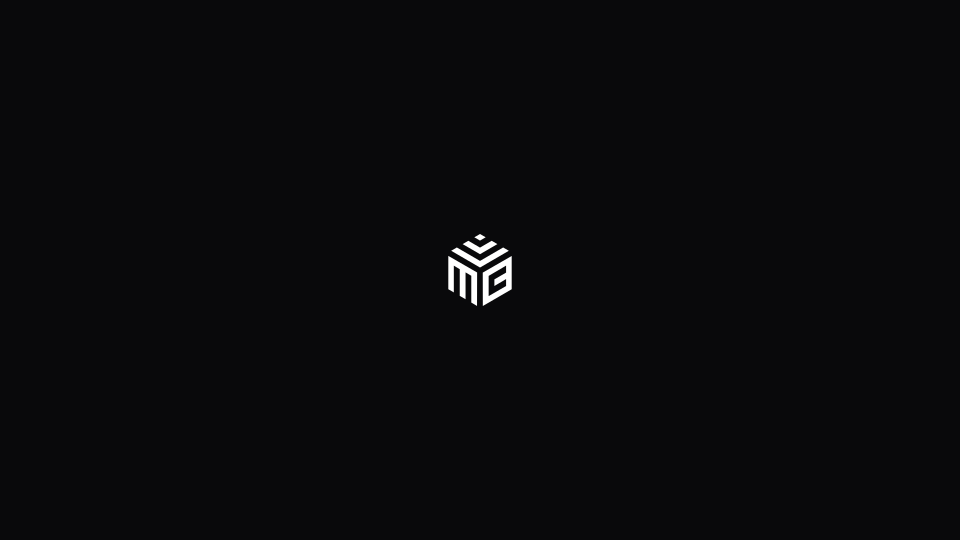

# Boxsmarchy

Theme dark Omarchy dari Catppuccin, mengikuti desain
[web mrboxs](https://mrboxs.isntboxs.workers.dev/): latar nyaris hitam,
panel graphite, teks putih, dan selection monokrom. Syntax dan palet ANSI
memakai warna lengkap One Dark.



Gambar di atas adalah preview wallpaper, bukan screenshot desktop.

## Instal di mesin sendiri

Butuh Omarchy 4.5 atau lebih baru. Dari checkout repo ini:

```bash
bash tools/install.sh
```

Script menyalin theme ke `~/.config/omarchy/themes/boxsmarchy`, lalu menerapkan
`omarchy theme set boxsmarchy`. Kalau Boxsmarchy sudah ada, salinan sebelumnya
dipindah ke `~/.local/state/omarchy/theme-backups/` dulu. Theme sistem di
`/usr/share/omarchy/` tidak diedit.

Untuk memasang tanpa langsung mengganti tampilan:

```bash
bash tools/install.sh --no-apply
omarchy theme set boxsmarchy
```

Kembali ke theme awal:

```bash
omarchy theme set catppuccin
```

## Instal lewat URL repo

```bash
omarchy theme install https://github.com/mrboxs/boxsmarchy-theme
```

Perintah ini mengambil versi yang sudah dipush ke GitHub. Omarchy menyaring
Lua dari theme yang di-clone, sehingga Neovim memakai Aether yang dihasilkan
dari palet One Dark. Untuk engine dan mapping `onedark.nvim`, jalankan
`bash tools/install.sh` dari checkout yang sudah lu baca. Config VS Code,
Helix, shell, wallpaper, dan palet terminal tetap didukung lewat instalasi URL.

## Yang ikut theme

| Bagian | Hasil |
| --- | --- |
| Shell, launcher, menu, notifikasi, lock | Dark monokrom dari `colors.toml` dan override shell |
| Terminal, btop, browser, app Omarchy lainnya | Dihasilkan oleh template Omarchy dari palet theme |
| Neovim | `onedark.nvim`, syntax One Dark dengan panel Boxsmarchy |
| VS Code, VSCodium, Cursor | Theme warna lokal Omarchy, semantic tokens dan TextMate One Dark |
| Helix | Mapping syntax One Dark dan UI monokrom |
| File manager | Ikon `Yaru-dark` |
| Wallpaper | PNG 3840 × 2160, logo asli brandkit |
| Unlock | Logo transparan dan preview; tersedia di Appearance > Unlock |

Neovim akan memasang `navarasu/onedark.nvim` lewat Lazy saat pertama dipakai.
Butuh koneksi internet untuk pemasangan plugin pertama. Integrasi editor
mengikuti toggle theme-sync Omarchy yang sudah lu atur.

Theme ini tidak mengganti font, keybinding, ukuran bar, opacity global, atau
layout desktop. Logo unlock tersedia untuk dipilih, tidak langsung dipasang
ke konfigurasi boot.

## Palet

| Peran | HEX |
| --- | --- |
| Background | `#09090b` |
| Panel | `#171717` |
| Foreground | `#fafafa` |
| Accent / focus | `#e5e5e5` |
| Selection kode | `#212121` |
| String | `#98c379` |
| Keyword | `#c678dd` |
| Function | `#61afef` |
| Type | `#e5c07b` |
| Number / constant | `#d19a66` |
| Variable / tag | `#e06c75` |
| Escape / regex | `#56b6c2` |

Comment memakai `#828997`, neutral sekunder One Dark yang lebih terbaca
di panel gelap daripada comment gray aslinya. Warna syntax lainnya tetap
memakai palet One Dark.

## Edit dan rebuild

- Edit `colors.toml` untuk warna yang dipakai generator Omarchy.
- Override `shell.*.toml` hanya mengubah bagian shell yang disebut di nama file.
- Kalau warna syntax diganti, selaraskan `neovim.lua`, `helix.toml`, dan `vscode-theme.json`.
- Source wallpaper ada di `sources/mrboxs-dark.svg`; master logo ada di `assets/brand/`.

```bash
bash tools/build-assets.sh
bash tools/install.sh
```

Rebuild aset membutuhkan `rsvg-convert` dan ImageMagick serta aset Plymouth
bawaan Omarchy. File PNG sudah disertakan, jadi instal theme tidak perlu rebuild.

Keputusan desain dicatat di [DESIGN.md](DESIGN.md), sumber aset dan palet di
[ATTRIBUTION.md](ATTRIBUTION.md), dan hasil pengecekan di [VALIDATION.md](VALIDATION.md).
