# Boxsmarchy

Theme dark Omarchy dari Catppuccin, mengikuti desain
[web mrboxs](https://mrboxs.isntboxs.workers.dev/): latar nyaris hitam,
panel graphite, teks putih, dan selection monokrom. Syntax dan palet ANSI
memakai warna lengkap One Dark.


Gambar di atas adalah preview wallpaper, bukan screenshot desktop.
Logo custom mengganti huruf `O` pada wordmark Omarchy dengan simbol mrboxs.
Huruf `MARCHY` dan geometri simbol asli dipertahankan, dengan warna aksen
`#e5e5e5` di atas background `#09090b`.

## Instal di mesin sendiri

Butuh Omarchy 4.5 atau lebih baru. Dari checkout repo ini:

```bash
bash tools/install.sh
```

Script menyalin theme ke `~/.config/omarchy/themes/boxsmarchy`, lalu menerapkan
`omarchy theme set boxsmarchy`. Kalau Boxsmarchy sudah ada, salinan sebelumnya
dipindah ke `~/.local/state/omarchy/theme-backups/` dulu. Theme sistem di
`/usr/share/omarchy/` tidak diedit.

Untuk memasang tanpa langsung mengganti tampilan:

```bash
bash tools/install.sh --no-apply
omarchy theme set boxsmarchy
```

Kembali ke theme awal:

```bash
omarchy theme set catppuccin
```

## Instal lewat URL repo

```bash
omarchy theme install https://github.com/mrboxs/boxsmarchy-theme
```

Perintah ini mengambil versi yang sudah dipush ke GitHub. Omarchy menyaring
Lua dari theme yang di-clone, sehingga Neovim memakai Aether yang dihasilkan
dari palet One Dark. Untuk engine, mapping, dan aturan bold `onedark.nvim`, jalankan
`bash tools/install.sh` dari checkout yang sudah lu baca. Config VS Code,
Helix, shell, wallpaper, dan palet terminal tetap didukung lewat instalasi URL.

## Yang ikut theme

| Bagian | Hasil |
| --- | --- |
| Shell, launcher, menu, notifikasi, lock | Dark monokrom dari `colors.toml` dan override shell |
| Terminal, btop, browser, app Omarchy lainnya | Dihasilkan oleh template Omarchy dari palet theme |
| Neovim | `onedark.nvim`, syntax One Dark dengan panel Boxsmarchy |
| VS Code, VSCodium, Cursor | Theme warna lokal Omarchy, semantic tokens dan TextMate One Dark |
| Helix | Mapping syntax One Dark dan UI monokrom |
| File manager | Ikon `Yaru-dark` |
| Logo | `logo.svg`, simbol mrboxs menggantikan O pada wordmark Omarchy |
| Ikon / Fastfetch | `icon.svg` dan PNG 600 × 600, frame Omarchy dengan simbol mrboxs di tengah |
| Wallpaper default | WEBP lossless 3840 × 2160, logo custom di tengah |
| Wallpaper alternatif | PNG 3840 × 2160 dengan simbol mrboxs saja |
| Unlock | Logo custom transparan dan preview; tersedia di Appearance > Unlock |

Neovim akan memasang `navarasu/onedark.nvim` lewat Lazy saat pertama dipakai.
Butuh koneksi internet untuk pemasangan plugin pertama. Integrasi editor
mengikuti toggle theme-sync Omarchy yang sudah lu atur.

Theme ini tidak mengganti font, keybinding, ukuran bar, opacity global, atau
layout desktop. Logo unlock tersedia untuk dipilih, tidak langsung dipasang
ke konfigurasi boot.

Wallpaper default untuk pemasangan baru adalah `00-boxsmarchy-dark.webp`.
Omarchy bisa mengingat wallpaper yang sebelumnya dipilih. Untuk memakai
default baru pada instalasi yang sudah ada:

```bash
omarchy theme bg set ~/.local/state/omarchy/current/theme/backgrounds/00-boxsmarchy-dark.webp
```

`preview.png` mengikuti wallpaper baru, sedangkan `unlock.png` dan
`preview-unlock.png` memakai master `logo.svg` yang sama. Logo lengkap
disarankan dipakai mulai lebar 184 px; untuk ikon kecil tetap gunakan
simbol dari `assets/brand/`.
Versi PNG 4K untuk dipakai di luar Omarchy ada di
[`assets/boxsmarchy-wallpaper.png`](assets/boxsmarchy-wallpaper.png).

## Logo Fastfetch

Setelah memasang theme, pasang logo ke Fastfetch dengan:

```bash
python3 tools/install-fastfetch.py
fastfetch
```

Script membaca config Fastfetch yang sedang digunakan, membuat backup di
`~/.local/state/omarchy/theme-backups/fastfetch-*/`, lalu hanya mengganti blok
`logo` pada `~/.config/fastfetch/config.jsonc` (atau lokasi `XDG_CONFIG_HOME`).
Modul, command, dan opsi display yang ada tetap dipertahankan. JSONC dengan
comment/trailing comma didukung; file hasil ditulis sebagai JSON yang dirapikan.
Menjalankan script lagi dengan pengaturan logo yang sama tidak mengubah config.

Profile `fastfetch-logo.json` menggunakan gambar `icon.png` melalui protokol
Kitty, cocok untuk Ghostty yang dipakai di mesin ini. Lebar ditentukan sebagai
54 kolom, sedangkan tinggi **tidak dipaksa**: Fastfetch menghitungnya dari rasio
PNG persegi dan ukuran pixel sel terminal. Ini menggantikan logo teks lama
yang bentuknya bergantung pada perbandingan lebar/tinggi karakter font.

Path gambar menunjuk ke theme terpasang, bukan ke checkout repo atau theme
sementara, jadi tetap tersedia saat berpindah theme. Pemasangan ulang theme
memperbarui gambar yang sama tanpa mengganti modul Fastfetch.

Kalau memakai Foot yang mendukung Sixel, jalankan:

```bash
fastfetch --logo-type sixel
```

Ikon lengkap direkomendasikan mulai 96 px; simbol mrboxs untuk ukuran kecil
tetap tersedia di `assets/brand/`. Detail perilaku rasio dan protokol ada di
[dokumentasi logo Fastfetch](https://github.com/fastfetch-cli/fastfetch/wiki/Logo-options).

## Palet

| Peran | HEX |
| --- | --- |
| Background | `#09090b` |
| Panel | `#171717` |
| Foreground | `#fafafa` |
| Accent / focus | `#e5e5e5` |
| Selection kode | `#212121` |
| String | `#98c379` |
| Keyword | `#c678dd` |
| Function | `#61afef` |
| Type | `#e5c07b` |
| Number / constant | `#d19a66` |
| Variable / tag | `#e06c75` |
| Escape / regex | `#56b6c2` |

Comment memakai `#828997`, neutral sekunder One Dark yang lebih terbaca
di panel gelap daripada comment gray aslinya. Warna syntax lainnya tetap
memakai palet One Dark.

## Fokus dan bobot token

Fokus aktif VS Code memakai bidang `#e5e5e5` dengan teks dan highlight
pencarian `#09090b`. Explorer dan Command Palette mengikuti perlakuan yang
sama. Fokus saat panel tidak aktif tetap gelap dengan outline yang terbaca.

Neovim, Helix, dan theme VS Code (termasuk VSCodium/Cursor) memakai hierarki
bobot yang sama:

- **Bold:** keyword/operator, fungsi/method/macro, tipe/class/interface,
  constructor, namespace, dan nama tag HTML/JSX.
- **Normal:** variabel/property/parameter, string, angka, nilai constant,
  dan atribut tag. Comment tetap italic tanpa bold.

VS Code menyertakan aturan TextMate dan semantic token. Neovim mengatur
syntax klasik, Tree-sitter, dan LSP supaya bold tetap ada saat language
server aktif. Palet warnanya tetap One Dark.

Terminal menampilkan bold ketika aplikasi di dalamnya meminta style tersebut
(ANSI SGR 1). Palet ANSI theme tidak bisa menentukan mana token keyword,
fungsi, atau string pada semua aplikasi CLI; aturan bold berada di config
editor/aplikasi yang mendukungnya. Theme tidak menebalkan seluruh font terminal.

## Edit dan rebuild

- Edit `colors.toml` untuk warna yang dipakai generator Omarchy.
- Override `shell.*.toml` hanya mengubah bagian shell yang disebut di nama file.
- Kalau warna syntax diganti, selaraskan `neovim.lua`, `helix.toml`, dan `vscode-theme.json`.
- Master logo custom ada di `logo.svg`; build wallpaper default dan unlock memakai file ini langsung.
- Master ikon Fastfetch ada di `icon.svg`; build menghasilkan `icon.png` persegi 600 × 600.
- Setelah edit ikon, pasang ulang theme untuk memperbarui gambar Fastfetch di path yang sama.
- Source wallpaper alternatif ada di `sources/mrboxs-dark.svg`; master mrboxs asli ada di `assets/brand/`.
- Referensi Omarchy dari pengguna disimpan utuh di `sources/omarchy-logo-original.svg` dan `sources/omarchy-reference.webp`.
- Referensi ikon Omarchy disimpan utuh di `sources/omarchy-icon-original.png`.

```bash
bash tools/build-assets.sh
bash tools/install.sh
```

Rebuild aset membutuhkan `rsvg-convert` dan ImageMagick serta aset Plymouth
bawaan Omarchy. File PNG sudah disertakan, jadi instal theme tidak perlu rebuild.

Keputusan desain dicatat di [DESIGN.md](DESIGN.md), sumber aset dan palet di
[ATTRIBUTION.md](ATTRIBUTION.md), dan hasil pengecekan di [VALIDATION.md](VALIDATION.md).
